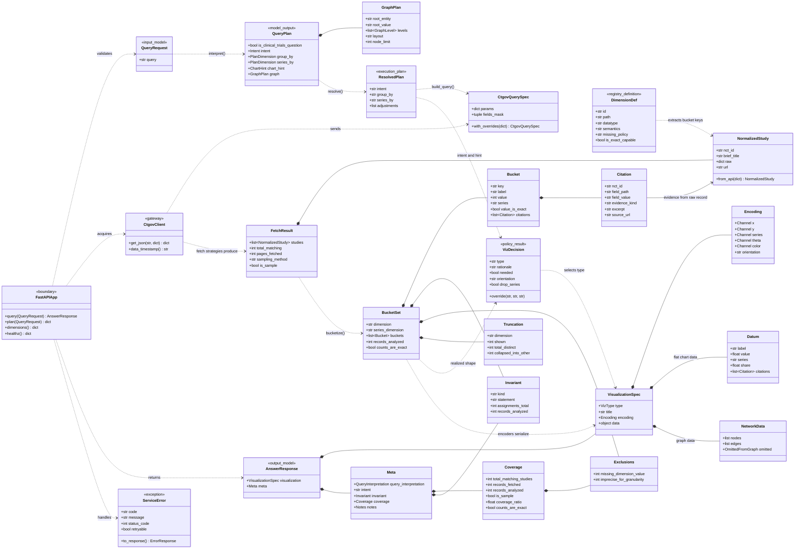
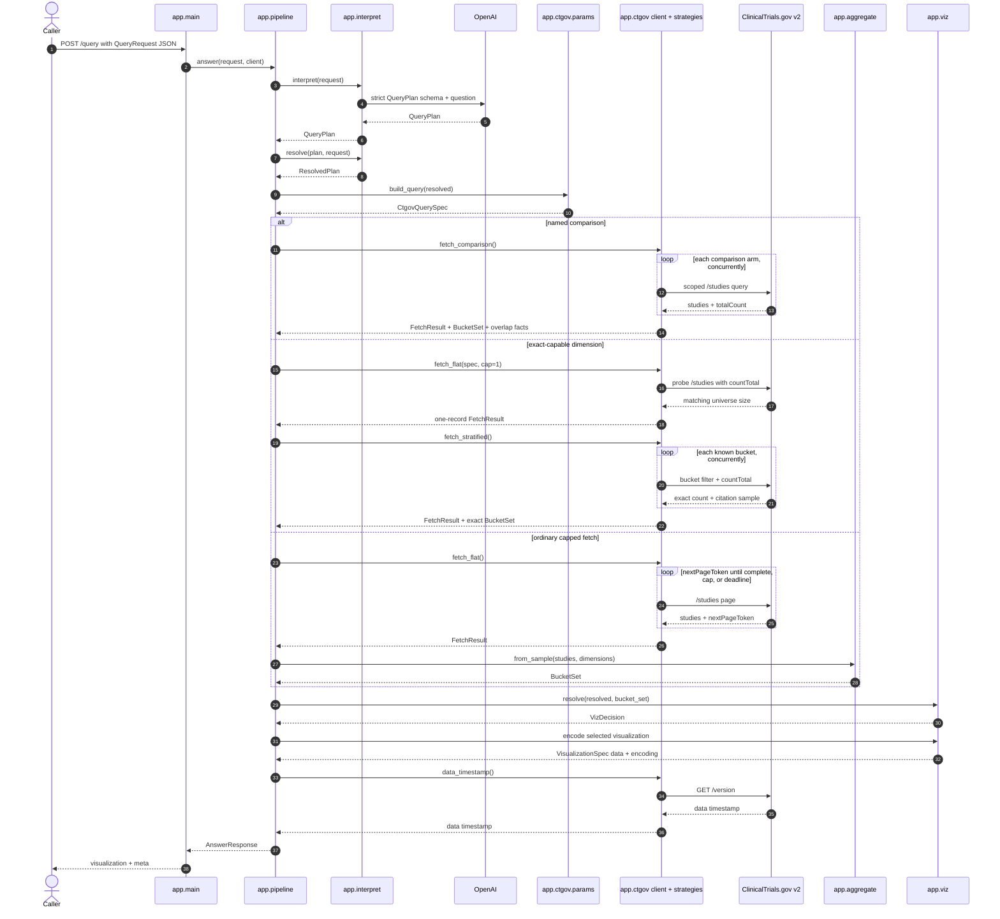

# Repository UML

These diagrams show the repository's stable architectural relationships rather
than every Pydantic field or private helper. The class diagram is the structural
map; the sequence diagram shows which modules collaborate during `POST /query`.

## Core class diagram

`QueryRequest` contains only the question. The language model proposes a
`QueryPlan`; `resolve()` then clamps and cross-validates it before any upstream
request is built. Everything after that boundary is deterministic.

## `POST /query` sequence diagram

The alternatives converge on `FetchResult` and `BucketSet`. That common
boundary lets coverage reporting and visualization selection remain unaware of
whether the data came from comparison arms, exact strata, or ordinary paging.
